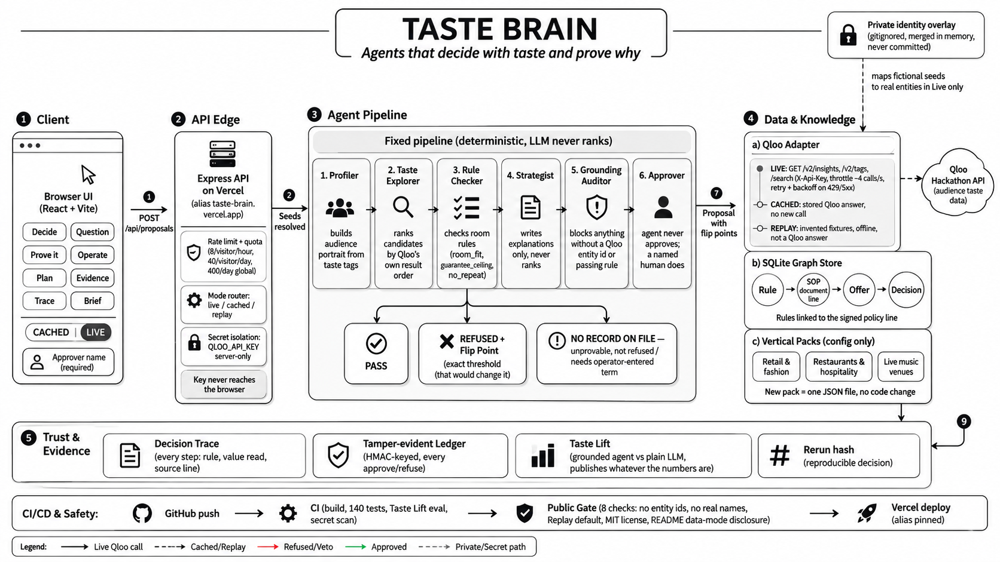

# Taste Brain

**Agents that decide with taste, and prove why.**

A multi-agent decision engine for businesses that buy with taste: retail buying, restaurant menus and live-music booking. Candidates come from real Qloo audience data, decisions are ruled by each business's own SOP, and every run produces an artifact a stranger can verify.

| | |
| --- | --- |
| **Live demo** | https://taste-brain.vercel.app |
| **Source** | https://github.com/amiteshsinghsps-star/taste-brain |
| **Built for** | Qloo Agentic Hackathon |
| **Licence** | MIT |
| **Tests** | 140 cases in 7 files, all passing |
| **Public-repo gate** | `npm run gate:public`, 8 checks, all pass |

---

## 1. Problem

Buyers, chefs and venue bookers all decide the same way: a gut feel about the audience, a spreadsheet of constraints, and a decision they must defend to someone (a merchant committee, a landlord, a head chef, a band's manager).

Two tools exist today and both fail at the same point:

- **Spreadsheets.** The constraints are real, the audience signal is a hunch, and the audit trail is someone's memory.
- **LLMs.** The prose is confident, entities are often invented, and nobody can tell a grounded recommendation from a plausible one afterwards.

The gap is not "recommend something". It is **"recommend something, follow our policy, and let us prove it later."**

## 2. Solution

Taste Brain splits the decision into three owners:

| Who | Supplies |
| --- | --- |
| **Qloo** | What this audience likes (ranked entities, popularity, explainability, audience tags) |
| **The business** | What is on policy (cost ceilings, guarantee ceilings, no-repeat windows, content rules) |
| **Taste Brain** | Why this one, in writing, with a trace, a ledger and a verifier |

Core principles:

1. **Qloo supplies taste.** Every candidate carries a Qloo entity id, rank, popularity and Qloo's own explanation.
2. **Rules are data.** A JSON threshold plus a line reference into the owner's SOP. Prose never becomes a rule.
3. **The LLM describes, never decides.** It may write an explanation. It cannot rank, filter, price or approve.
4. **Nothing is guessed.** Missing data reports `needs_data`, never `pass`. Ambiguous names return candidates. Missing booking terms block approval.
5. **A named human approves.** The decision is written to a hash-chained, tamper-evident ledger.

## 3. How It Uses Qloo

Base URL `https://hackathon.api.qloo.com`, server-side key only.

| Endpoint | Used for |
| --- | --- |
| `GET /search` | Resolve taste seeds to real entities (ambiguity returns candidates, never a guess) |
| `GET /v2/tags` | Tag guards and exclusions |
| `GET /v2/insights` | Ranked candidates, audience portrait (`filter.type=urn:tag`), location-lift variants |
| `GET /v2/analysis/compare` | Audience overlap for partner suggestions |

What Qloo provides that a self-contained recommender cannot: **a third-party entity id and a third-party explanation attached to every result**, which is what makes grounding checkable.

How the integration stays safe:

- **Parameter allowlist per endpoint.** An unverified parameter throws before the request leaves the process.
- **Throttle and retry.** Minimum 220 ms gap, 15 s timeout, retries on 429 and 5xx only (a 400 is a bug, never retried).
- **Capability gate.** A Qloo capability enters the product only if it returned rows on this key. `/v2/trending` is allowlisted but never called.
- **No invented scores.** `/v2/insights` returns no score field, so `fit` is Taste Brain's own derivation from Qloo's rank and is labelled "(derived)" everywhere.
- **Audience level only.** Only entity ids, tags and a location signal are sent. Nothing about an individual.

## 4. Architecture




Layers, top to bottom:

| Layer | Responsibility | Forbidden from |
| --- | --- | --- |
| **Client** (React 19, 17 screens, 4 groups) | Paint what the server sent | Computing any number or re-sorting a list |
| **HTTP** (Express, zod, 30 routes) | Validation, rate limit, status codes | Business logic |
| **Pipeline** | Sequence the run, stamp mode, build the trace | Talking to Qloo directly |
| **Agents** (13 modules) | One decision each | Acting outside their authority |
| **Qloo adapter / REST client** | Session, budget, allowlist, cache, retries | Ranking |
| **Graph store** (`node:sqlite`) | Nodes, edges, proposals, snapshots, ledger, quota | Answering the browser directly |
| **Verify / Break-it** | Recompute and attack the defences | Touching the real ledger |

The key cut: **the pipeline never talks to Qloo.** Everything goes through the adapter, so budget, allowlist, throttle and mode stamping cannot be bypassed by a new stage.

### Pipeline

1. Resolve the room (pack, seeds, rules, catalogue).
2. Grant or degrade the data mode (live, cached, replay).
3. Profile the audience (resolve seeds through `/search`).
4. Describe the audience (aggregate tags only).
5. Rank candidates (one constrained `/v2/insights` query).
6. Relax only if empty, in a fixed visible order, re-applying the tag guard locally.
7. Rule check: `pass`, `fail` or `needs_data` per rule.
8. Ground audit: five numbered checks per item.
9. Narrate (LLM optional, output discarded if ungrounded).
10. Store proposal, snapshot and a `proposed` ledger entry.
11. A named human approves or rejects; the decision is hash-chained.

## 5. Agents

| Class | Agents | Role |
| --- | --- | --- |
| **In-run** | Profiler, Audience, Taste Explorer, Rule Checker, Strategist (LLM), Grounding Auditor, Approver (human) | Move the decision forward |
| **Question** | Why-not, What-if, Partners, Brief, Ablation | Read-only, never re-decide |
| **Guardians** | Auditor, Verifier, Break-it harness, Quota meter, Public gate | Police everything else |

The separation of powers is structural: twelve of thirteen agent modules cannot write the ledger, and no guardian can spend the Qloo key.

## 6. Features

**Decide**
- **Plan:** pick a vertical and room, run the agent, get ranked items with Qloo rank, popularity, explanation and rule verdicts.
- **Audience portrait:** Qloo's own aggregate taste tags for the room.
- **Operator term entry:** missing commercial terms (e.g. guarantee) are typed by a human, stored and ledgered, never attributed to Qloo.
- **Evidence / Trace / Brief:** per-item grounding, ordered step trace, downloadable six-section approval brief.

**Question**
- **Why not?** Seven honest verdicts, including `not_returned_by_qloo`. Never an invented excuse.
- **What if?** Change a threshold and re-cut the list offline with 0 Qloo calls.
- **Partners:** audience-overlap co-promotion candidates. Overlap is not agreement, and the UI says so.

**Prove it**
- **Verify:** six recomputed checks over an exported decision, via CLI, API or browser.
- **Break it:** six real attacks against the real defences. Blocked and successful are both data.
- **Ablation:** five arms including a shuffled-Qloo control with fixed seed 42.
- **Trust:** thirteen guardrail checks with evidence. **Coverage:** every Qloo capability used and its probe date. **Ledger:** re-verify the whole chain.

**Operate**
- **Budget:** live quota buckets and the REST call log (counts and hashes only).
- **Finals Mode:** serve stored snapshots with zero network calls.
- **Taste Lift** and **About** (what is real, what is invented, what was not measured).

## 7. Rules and Flip Points

Rules are typed, cite an SOP line, and have three states:

| State | Meaning | Result |
| --- | --- | --- |
| `pass` | Data on file, rule satisfied | Approvable |
| `fail` | Data on file, rule broken | Refused, with a flip point |
| `needs_data` | Data not on file | Blocked until a human enters it (or flagged) |

| Pack | Rules |
| --- | --- |
| Retail | `budget_cap` (unit cost <= $40), `min_order` (<= 500), `brand_safety` |
| Restaurants | `margin_floor` (food cost <= 32%), `dietary_shellfish` |
| Venues | `room_fit` (popularity band), `guarantee_ceiling` (<= $8,000), `no_repeat`, `matinee_content` |

Every refusal answers "what would change this?" with a **flip point**, proven in both directions: the flipped value passes and one step back still fails. Example: *raising the guarantee ceiling from 8000 to 9500 admits Vex; at 9400 it still fails.*

## 8. Data Modes: Never a Fourth

| Mode | Badge | Source |
| --- | --- | --- |
| `live` | LIVE | Fetched this run, over HTTPS, with the key |
| `cached` | CACHED | A stored real Qloo response, labelled as such |
| `replay` | SAMPLE | Committed offline fixtures, invented data, not a Qloo answer |

Every trace step carries its own mode and the run badge is **derived from the steps**, so it cannot overstate. Going over budget is not an error: it returns `HTTP 200` in about half a second, all steps labelled Cached, with a reason sentence naming the budget.

## 9. What Makes It Different

| Usual hackathon shape | Taste Brain |
| --- | --- |
| A "live data" banner for the whole page | A mode label per step; badge computed from the steps |
| HTTP error or a silent cached page when over quota | `200`, labelled Cached, reason shown, Replay still works |
| Model output is the ranking | Qloo order plus deterministic rules; LLM barred from the decision path |
| Unsupported items hidden | Counted and shown as a first-class result |
| "Trust our eval numbers" | Six re-derivable checks plus a Break-it suite on the shipped artifact |
| Log lines | Hash-chained, HMAC-keyed ledger with external anchor |
| Own guardrail failures unreported | Found, fixed and regression-tested in public |
| Key pasted in `.env` and committed | Server-side only; CI gate fails on any tracked credential or real name |

Exceptional build details:

- **Zero arithmetic in the client.** If the server does not know something, the UI shows a blank or "not measured".
- **Refuses to guess.** Missing guarantee, ambiguous seed (e.g. an ambiguous venue name returns Hall & Oates, Thalia, Tally Hall...) and absent entities are all reported honestly.
- **The verifier is a tool, not a boolean.** It names the first failing record, for example a rank and a field.
- **Documented its own bug.** A verifier check once accused an intact run of tampering because it read neighbouring proposals' ledger entries. It was fixed and two regression tests pin the corrected behaviour.
- **Verticals are files, not code.** Retail, restaurants and venues are three JSON packs; a new vertical is a pack, a rule set and an SOP reference.

## 10. Integrity and Verification

- **Decision Trace:** typed, ordered, mode-stamped steps citing rule and SOP line.
- **Ledger:** SHA-256 chain, or HMAC-SHA256 when `LEDGER_HMAC_SECRET` is set. Canonical JSON, algorithm stored inside the hashed detail, `npm run ledger:anchor` publishes the head externally.
- **`rerun_hash` v2:** hashes `{id, name, rank, verdict}` of decision steps, binding names so rename forgeries fail.
- **Verifier checks:** `chain`, `decision_bound`, `qloo_ids`, `ranking`, `rules`, `modes`.
- **Break-it attacks:** `unsupported_item`, `entity_name_injection`, `policy_text_injection`, `ledger_tamper`, `budget_exceeded`, `unverified_parameter`. Result on the host: 6 of 6 blocked with `network_calls_before == after`.

## 11. Tech Stack

| Area | Technology |
| --- | --- |
| Backend | Node 22+, Express, TypeScript (CommonJS), zod at every boundary |
| Frontend | React 19, Vite, Tailwind v4 |
| Storage | `node:sqlite` (no ORM, no daemon) |
| Data source | Qloo REST (`/search`, `/v2/tags`, `/v2/insights`, `/v2/analysis/compare`) |
| LLM (optional) | OpenAI-compatible chat completions, temperature 0, text only |
| Testing | Vitest, 140 cases, no network |
| CI | GitHub Actions on Node 22, keyless and Replay-only |
| Hosting | Vercel serverless (also Docker on `node:24-slim`, or localhost) |

## 12. Security Model

- **Key never leaks:** server-side only, optional in the schema, never logged, never in a response or the client bundle.
- **No real identity published:** committed packs are fictional; real names and entity ids live in a gitignored overlay delivered via `PACK_OVERLAY_B64`. `gate:public` scans every tracked line.
- **Injection:** sanitised names, length-capped text, 64 kb body cap, id regex, policy text treated as data.
- **Spend control:** four quota buckets (visitor-hour 6, visitor-day 40, global-day 300, monthly floor 1500), 12 calls per run, 400 harness soft limit, 30 req/min per IP.
- **Export gate:** live runs are not exportable by default, so bulk Qloo identity data stays out of shared files.

## 13. Venue Walkthrough (Live Demo)

1. Open https://taste-brain.vercel.app and pick **Live music venues**, then **Corner Hall, Headline Room, Chicago**, mode **LIVE**.
2. Goal: `Book 3 acts for the autumn series in this room`. Press **Run the agent**.
3. Expect 25 real Qloo artists, an audience portrait, all items "waiting on a term", and the ambiguous-seed warning (the engine refuses to guess).
4. Type an approver name, enter a guarantee of `6000` for one act (approves under the $8,000 ceiling) and `9000` for another (refused, flip point shown).
5. Open **Prove it** for the ledger, Verify and Break it.
6. For the offline story, use **Red Room + CACHED/Replay**: DJ Marlow approves, Vex shows the flip point, Paper Lanterns fails `no_repeat`.

## 14. Quickstart (No Key Needed)

```bash
cd server && npm ci && npm run dev            # API on :4000, Replay mode
cd client && npm ci && npm run build          # client served from server/public
cd server && npm run smoke:replay             # full run, zero network
cd server && npm test                         # 140 cases
cd server && npm run gate:public              # 8 public-safety checks
cd server && npm run verify -- verification/sample-export.json
```

With a Qloo key, add `server/.env`:

```ini
QLOO_ENABLED=true
DEFAULT_MODE=live
QLOO_API_KEY=<your key>
```

Fresh clones default to `QLOO_ENABLED=false` and `DEFAULT_MODE=replay`, so the repository is safe to publish and runs with no credential.

## 15. Limits (Stated Plainly)

- Qloo returns aggregate audience affinities, not evidence about any individual.
- Recommendations are decision support. No revenue or business outcome is claimed or measured.
- The verifier proves internal consistency, not that Qloo is correct or the recommendation is good.
- Serverless disk is ephemeral: quota counters and the ledger are per-instance.
- Taste Lift Arm A needs an LLM key and has not run on the host, so no lift number is implied.
- Booking terms are never supplied by Qloo; they are operator-entered by design.

## 16. Links

- **Live demo:** https://taste-brain.vercel.app
- **Source:** https://github.com/amiteshsinghsps-star/taste-brain
- **Licence:** MIT (c) 2026 Taste Brain contributors

*Qloo supplies the taste, the room's rules decide, and missing terms are never guessed.*
## Data mode

Every result is labelled Live, Cached or Replay. Replay and Sample rows are invented fixture data committed to this repository so the app runs with no key and no network; they are not a Qloo answer and are never presented as one. A fresh clone is credential-free (QLOO_ENABLED=false, DEFAULT_MODE=replay). The hosted demo runs with QLOO_ENABLED=true so judges see real Qloo reads. Disclosed 2026-10-30 against this tree.
