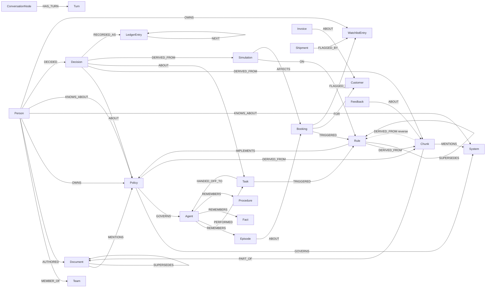

# Graph data model

Reference document for the FalkorDB schema actually implemented in `server/src/`.
Every label, property, relationship, index and naming rule below is taken from
source; nothing is aspirational. Line references point at the code as of this
writing.

## 1. Stores: what lives where

FalkorDB is the system of record for company knowledge: documents, chunks,
embeddings, people, teams, policies, rules, decisions, tasks, bookings,
watchlist entries, agent memory (episodes/facts/procedures/conversation turns),
simulation records, the hash-chained decision ledger, reader feedback verdicts
and pinned queries are all graph nodes and
edges, stored in one graph per tenant. Postgres (Prisma) is deliberately
narrow: it holds authentication, connector/sync metadata, the raw ingested
payload, per-user skill-rule rows, agent instance/task rows and audit rows.
`server/src/services/brain/graph.service.ts:22-28` states this explicitly
("This fully replaces the old Prisma Entity/EntityRelation 'graph'").

Verified against `server/prisma/schema.prisma` — the Postgres tables that remain:

| Table (`@@map`) | Model | Lines | Role |
|---|---|---|---|
| `users` | `User` | 104-124 | Auth identity, `passwordHash`, `role` |
| `refresh_tokens` | `RefreshToken` | 126-139 | Rotating refresh-token hashes, revocation |
| `data_sources` | `DataSource` | 141-157 | Connector metadata, `SyncStatus`, `composioConnectionId`, `lastSyncedAt` |
| `ingested_documents` | `IngestedDocument` | 159-181 | Raw synced/uploaded document content (`content`, `mimeType`, `chunkCount`) |
| `knowledge_chunks` | `KnowledgeChunk` | 183-194 | Chunk text as ingested (input to graph extraction) |
| `entities` | `Entity` | 196-207 | Legacy pre-graph entity table; still present in the schema |
| `entity_relations` | `EntityRelation` | 209-222 | Legacy pre-graph relation table; still present in the schema |
| `skill_rules` | `SkillRule` | 224-243 | Editable executable-rule rows (mirrored into the graph, see §3 `Rule`) |
| `brain_query_logs` | `BrainQueryLog` | 245-258 | Query/answer/citation audit rows + `traceId` |
| `agent_instances` | `AgentInstance` | 260-276 | Agent definition, `AgentMode` (COPILOT/AUTOPILOT), status |
| `agent_tasks` | `AgentTask` | 278-294 | Task rows with `inputPayload` / `outputResult` JSON |
| `agent_audit_logs` | `AgentAuditLog` | 296-310 | Append-only action audit |
| `team_members` | `TeamMember` | 312-326 | Org members + `TeamRole` |
| `access_grants` | `AccessGrant` | 328-338 | 6-scope allow/deny per member |
| `email_desk_messages` | `EmailDeskMessage` | 340-356 | Email desk inbox, staged draft, sent status |

Notes a reviewer should be aware of:

- The legacy `Entity` / `EntityRelation` tables are still in
  `server/prisma/schema.prisma:196-222` (with `EntityType` and `RelationType`
  enums at lines 32-47). No service in `server/src/services/` writes or reads
  them; the replacement is graph-side, not a schema migration.
- `IngestedDocument` / `KnowledgeChunk` still hold the *text* of every document
  and chunk. The graph holds the queryable projection (`Document`/`Chunk`
  nodes + embeddings). `ExtractionService.extractFromTenantDocuments` reads SQL
  as the source list and then materialises graph nodes
  (`server/src/services/brain/extraction.service.ts:83-108`).
- Skill rules are dual-written: the row in `skill_rules` is authoritative for
  execution, and `SkillsService.mirrorSkillToGraph` echoes it into the graph as
  `Rule` + `Policy` (`server/src/services/brain/skills.service.ts:234-277`).
- Nothing caches graph totals. `GET /api/status` and `GET /api/status/graph`
  (`server/src/services/brain/status.service.ts`) ask the live graph for
  `CALL db.meta.stats()` on every call, so the node/edge numbers a reviewer
  sees cannot be a stale Postgres counter or a hard-coded string. The public
  aggregate sums across at most 100 graphs and never returns tenant names or
  ids.

## 2. Node labels

Allow-list is `NODE_LABELS` in `server/src/graph/graph.schema.ts:9-39`
(29 labels). `isNodeLabel()` (lines 78-80) gates any label coming from LLM
extraction or client input before it reaches Cypher.

Properties are stored as graph property values; note that several numeric/bool
values are written as **strings** in this codebase (e.g. `version`, `atMs`,
`seq`, `isExecutable`, `demoSeed`) because that is how the call sites pass them.
Queries then cast with `toInteger()` where ordering matters.

| Label | Purpose | Key properties (name: how it is written) | Creating code path |
|---|---|---|---|
| `Person` | Employee/owner/expertise subject | `name`, `email`, `role`, `teamId`, `searchKey` (`person:<normalized>`), `demoSeed`, `sourceLabel` | `server/src/seed/northwind.seed.ts:19-24` (seedPerson); `server/src/services/brain/extraction.service.ts:213-241` (LLM/heuristic entities); `server/src/services/agent/agent-workflows.service.ts:338-343` (the approving human, id `person_user_<userId>`, merged on approve so a real account appears in the graph) |
| `Team` | Department grouping | `name`, `demoSeed` | `server/src/seed/northwind.seed.ts:36-43` |
| `Agent` | Graph-side agent persona | `name`, `type`, `mode`, `status`, `demoSeed` | `server/src/seed/northwind.seed.ts:165-167`; synthetic memory agent `server/src/services/memory/memory.service.ts:44-47` |
| `Project` | Allow-listed for extraction only (`PROJECT: 'Project'`) | `name`, `searchKey`, `aliasesJSON`, `sourceLabel` | `server/src/services/brain/extraction.service.ts:145-149,241` — no seed or service creates one directly |
| `System` | Software/process that policies govern | `name`, `kind`, `searchKey`, `demoSeed` | `server/src/seed/northwind.seed.ts:64-73`; `server/src/services/brain/extraction.service.ts:283-284` |
| `Document` | Versioned source document | `title`, `sourceType`, `sourceUrl`, `version`, `hash` (sha256 of content), `status` (`ACTIVE`/`SUPERSEDED`), `validFrom`, `validTo`, `createdAt`, `demoSeed`, `sqlId` (only via extraction path) | `server/src/services/brain/graph.service.ts:69-80` (ingestDocument); `server/src/services/brain/extraction.service.ts:301-313`; `server/src/seed/northwind.seed.ts:186-197`; `server/src/seed/seed-v3.ts:103-114` |
| `Chunk` | Retrieval unit; carries the embedding | `text`, `idx`, `documentId`, `embedding` (float32 via `vecf32()`), `demoSeed`, `sqlId` (extraction path) | `server/src/services/brain/graph.service.ts:82-91`; `server/src/services/brain/extraction.service.ts:329`; `server/src/seed/northwind.seed.ts:208-209`; `server/src/seed/seed-v3.ts:118-119` |
| `Message` | Allow-listed only. `inferLabel` maps a `channel` property to `Message` (`server/src/services/brain/graph.service.ts:281`) but no code path creates the node | — | **not implemented** |
| `Ticket` | Allow-listed only | — | **not implemented** |
| `Policy` | Governance statement, versioned + owned | `name`, `policyName`, `category`, `version`, `status` (`ACTIVE`/`REVIEW_PENDING`/`SUPERSEDED`), `validFrom`, `validTo`, `demoSeed`; extracted policies add `description` | `server/src/seed/northwind.seed.ts:221-230`; `server/src/services/brain/extraction.service.ts:232-237`; `server/src/services/brain/skills.service.ts:257-264`; orphan demo policy `server/src/seed/seed-v3.ts:199-208` |
| `Rule` | Executable or reviewable rule | `ruleName`, `actionType`, `triggerCondition`, `severity`, `parametersJSON`, `version`, `isExecutable` (`'true'`/`'false'`), `status` (`ACTIVE`/`STALE`/`REVIEW_PENDING`/`SUPERSEDED`), `description`, `staleReason`, `validTo`, `demoSeed` | `server/src/seed/northwind.seed.ts:286-296`; `server/src/services/brain/extraction.service.ts:264-276`; `server/src/services/brain/skills.service.ts:246-255`; `server/src/seed/seed-v3.ts:125-135,210-221`; new version on Apply `server/src/services/brain/simulation.service.ts:165-175` |
| `Decision` | Human/agent decision record | `summary`, `outcome`, `at`, `mode`, `demoSeed` | `server/src/seed/northwind.seed.ts:357-363`; `server/src/services/brain/simulation.service.ts:195-201`; `server/src/services/agent/agent-workflows.service.ts:317-322` |
| `Task` | Agent work item | `kind`, `status`, `createdAt`, `summary`, `bookingRef`, `sqlId` | `server/src/seed/northwind.seed.ts:378-384`; `server/src/services/agent/agent-workflows.service.ts:101-107`, `:275-280` (handoff), `:323-329` and `:435-441` (SQL-task mirror) |
| `Episode` | Episodic memory | `summary` (≤800 chars), `outcome`, `at`, `scope`, `agentId`, `demoSeed` | `server/src/services/memory/memory.service.ts:33-39`; `server/src/seed/northwind.seed.ts:391-397` |
| `Fact` | Semantic memory | `statement`, `confidence` (string 0..1), `at`, `scope`, `agentId`, `demoSeed` | `server/src/services/memory/memory.service.ts:64-70`; `server/src/seed/northwind.seed.ts:400-406` |
| `Procedure` | Procedural memory | `name`, `stepsJSON` (≤4000 chars), `version`, `scope` | `server/src/services/memory/memory.service.ts:84-89` |
| `ConversationNode` | Chat thread container (`Conversation` avoided as a Redis reserved word — `server/src/graph/graph.schema.ts:41-42`) | `id`, `scope`, `createdAt`, `demoSeed` | `server/src/services/memory/memory.service.ts:126`; `server/src/seed/northwind.seed.ts:408` |
| `Turn` | One chat message | `role`, `text` (≤2000 chars), `at`, `scope`, `demoSeed` | `server/src/services/memory/memory.service.ts:127-132`; `server/src/seed/northwind.seed.ts:409` |
| `WatchlistEntry` | Denied-party screening row | `name`, `list`, `note`, `addedBy`, `at`, `demoSeed` (`'true'` for the three seeded rows, `'false'` for tenant-added) | seeded `server/src/seed/northwind.seed.ts:175-177`; tenant write path `server/src/services/brain/watchlist.service.ts:135-142` (id `watch_custom_<slug>`, idempotent on lower-cased name, refuses to delete a seeded row at lines 170-172) |
| `Customer` | Counterparty | `name`, `creditStatus`, `demoSeed` | `server/src/seed/northwind.seed.ts:323`; `server/src/seed/seed-v3.ts:147-149`; extraction path `server/src/services/brain/extraction.service.ts:241` |
| `Shipment` | Demo shipment record | `bookingNumber`, `status`, `demoSeed` | `server/src/seed/northwind.seed.ts:322` — only creator |
| `Invoice` | Finance document | `invoiceNumber`, `amount`, `currency`, `demoSeed` | `server/src/seed/northwind.seed.ts:324`; `server/src/seed/seed-v3.ts:193` |
| `Booking` | Replayable rule-engine input + recorded verdict | `bookingNumber`, `input` (JSON string of `BookingInput`), `at` (ISO), `atMs` (string ms), `recordedVerdict`, `value`, `customerId`, `demoSeed` | `server/src/seed/seed-v3.ts:171-180`; live agent run `server/src/services/agent/agent-workflows.service.ts:83-90` |
| `Simulation` | Counterfactual policy replay record | `status` (`PROPOSED`/`APPLIED`/`DISCARDED`), `ruleId`, `ruleName`, `candidateParams` (JSON string), `total`, `changed`, `replayFidelity`, `at`, `demoSeed` | `server/src/services/brain/simulation.service.ts:110-120` |
| `LedgerEntry` | Hash-chained audit entry | `id`, `seq`, `at`, `actor`, `kind`, `subjectId`, `traceId`, `payloadHash`, `prevHash`, `hash` | `server/src/services/brain/ledger.service.ts:89-97` (raw `CREATE`, not `mergeNode`) |
| `HealthFinding` | Persisted health-report snapshot | `score` (string), `findingsJSON` (≤8000 chars), `at` | `server/src/services/brain/health.service.ts:93-97` |
| `Feedback` | Reader verdict on one brain answer (Track 04) | `id`, `at`, `verdict` (`UP`/`DOWN`), `question` (≤500), `comment` (≤500), `traceId`, `answerSnippet` (≤500), `givenBy` (≤160), `linkedChunksJSON` | `server/src/services/brain/feedback.service.ts:53-85`; linked to each cited `Chunk` with `ABOUT` only after the chunk id is confirmed to exist in this graph (lines 76-82) |
| `SavedQuery` | Pinned brain question for the tenant (Track 04) | `id`, `question` (≤500), `snippet` (≤500), `traceId`, `createdAt`, `givenBy` | `server/src/services/brain/saved-query.service.ts:39-66` — idempotent on the exact question string |
| `EvalRun` | Allow-listed only | — | **not implemented** — eval results are computed in `server/src/services/brain/eval.service.ts` and aggregated in memory / `server/src/eval/results.json`; no `EvalRun` node is ever written |

Merge-key convention: entity nodes are upserted with `MERGE (n:<Label> {id: $id})`
(`server/src/graph/graph.queries.ts:48`), and entity resolution for extracted
entities uses `searchKey = "<Label>:<normalizeName(name)>"`
(`server/src/services/brain/extraction.service.ts:214-219`;
`normalizeName` is defined at `server/src/graph/graph.schema.ts:85-91` — it
lowercases, strips non `[a-z0-9 ]`, collapses whitespace).

## 3. Relationship types

Allow-list is `RELATIONSHIP_TYPES` in `server/src/graph/graph.schema.ts:45-74`
(28 types), gated by `isRelationshipType()` (lines 82-84). Track 04 added no new
relationship types — its two new labels reuse existing edges (`ABOUT`, `OWNS`).

| Type | Direction semantics | Properties | Creating call site |
|---|---|---|---|
| `MEMBER_OF` | `Person` → `Team` | — | `server/src/seed/northwind.seed.ts:22` |
| `OWNS` | `Person` → `Policy` (accountable owner); also `Person` → `WatchlistEntry` for a tenant-added entry when a matching Person node exists | — | `server/src/seed/northwind.seed.ts:233`; extraction `server/src/services/brain/extraction.service.ts:251-258`; `server/src/services/brain/watchlist.service.ts:146-154` |
| `AUTHORED` | `Person` → `Document` | — | `server/src/seed/northwind.seed.ts:201` |
| `PART_OF` | `Chunk` → `Document` | — | `server/src/services/brain/graph.service.ts:90`; `server/src/services/brain/extraction.service.ts:330`; `server/src/seed/northwind.seed.ts:210`; `server/src/seed/seed-v3.ts:120` |
| `MENTIONS` | `Document`/`Chunk` → entity | — | `server/src/services/brain/extraction.service.ts:246-247`, `:285` |
| `DERIVED_FROM` | `Rule`/`Policy`/`Decision` → `Chunk` (provenance); also `Decision` → `Simulation`, and reverse `Chunk` → `Rule` (see limitations) | — | `server/src/seed/northwind.seed.ts:238,300,371`; `server/src/services/brain/extraction.service.ts:277-279`; `server/src/services/memory/memory.service.ts:72`; `server/src/services/brain/simulation.service.ts:209` |
| `IMPLEMENTS` | `Rule` → `Policy` | — | `server/src/seed/northwind.seed.ts:297`; `server/src/services/brain/skills.service.ts:265`; `server/src/seed/seed-v3.ts:137,222`; `server/src/services/brain/simulation.service.ts:184` |
| `GOVERNS` | `Policy` → `System` / `Policy` → `Agent` | `evidence` when created by extraction | `server/src/seed/northwind.seed.ts:241-252`; extraction `server/src/services/brain/extraction.service.ts:251-258` |
| `REQUIRES` | `System` → `Policy` (extraction/heuristic only) | `evidence` | `server/src/services/brain/extraction.service.ts:357` (heuristic) then `:257` |
| `VALIDATES` | subject → object, extraction only | `evidence` | `server/src/services/brain/extraction.service.ts:251-258` (LLM output); read in filters elsewhere |
| `APPROVES` | Approver → subject; read in retrieval expansion filter only | `evidence` when created by extraction | `server/src/services/brain/extraction.service.ts:251-258` only — no seed or workflow writes it |
| `SUPERSEDES` | new version → old version, on `Document` and on `Rule` | — | `server/src/services/brain/graph.service.ts:94`; `server/src/seed/seed-v3.ts:123,136`; `server/src/services/brain/simulation.service.ts:181` |
| `DECIDED` | `Person` → `Decision` | — | `server/src/seed/northwind.seed.ts:364`; `server/src/services/brain/simulation.service.ts:204`; `server/src/services/agent/agent-workflows.service.ts` (`approveTask` — the human who clicked Approve, id `person_user_<userId>`) |
| `ABOUT` | `Decision` → `Policy`/`Task`; `Episode` → any; `Invoice` → `Customer`; `Feedback` → `Chunk` | — | `server/src/seed/northwind.seed.ts:325,366,399`; `server/src/services/brain/simulation.service.ts:207`; `server/src/services/agent/agent-workflows.service.ts:332,356`; `server/src/services/memory/memory.service.ts:52`; `server/src/seed/seed-v3.ts:194`; `server/src/services/brain/feedback.service.ts:81` |
| `PERFORMED` | `Agent` → `Task` (seed also uses `Agent` → `Shipment`, see limitations) | — | `server/src/seed/northwind.seed.ts:328,387`; `server/src/services/agent/agent-workflows.service.ts:108,282,442` |
| `HANDED_OFF_TO` | `Task` → `Agent` (seed also uses `Task` → `Agent` reversed role assignment) | — | `server/src/seed/northwind.seed.ts:386`; `server/src/services/agent/agent-workflows.service.ts:281` |
| `TRIGGERED` | `Task` → `Rule`; `Booking` → `Rule` | — | `server/src/seed/northwind.seed.ts:327,385`; `server/src/services/agent/agent-workflows.service.ts:111-112` |
| `REMEMBERS` | `Agent` → `Episode` / `Fact` / `Procedure` | — | `server/src/services/memory/memory.service.ts:41,48,75,91`; `server/src/seed/northwind.seed.ts:398,407` |
| `HAS_TURN` | `ConversationNode` → `Turn` | — | `server/src/services/memory/memory.service.ts:133`; `server/src/seed/northwind.seed.ts:410` |
| `KNOWS_ABOUT` | `Person` → `System` / `Policy`; carries `weight` | `weight` (number) | `server/src/seed/northwind.seed.ts:317-319` |
| `FLAGGED_BY` | `Booking` → `WatchlistEntry` (seed uses `Shipment` → `WatchlistEntry`) | — | `server/src/seed/northwind.seed.ts:326`; `server/src/services/agent/agent-workflows.service.ts:125` |
| `FOR` | `Booking` → `Customer` | — | `server/src/seed/seed-v3.ts:181`; `server/src/services/agent/agent-workflows.service.ts:98` |
| `ON` | `Simulation` → `Rule` (the rule under test) | — | `server/src/services/brain/simulation.service.ts:121,191` |
| `AFFECTS` | `Simulation` → `Booking` (diff rows, capped at 50) | — | `server/src/services/brain/simulation.service.ts:122-124` |
| `NEXT` | newer `LedgerEntry` → previous `LedgerEntry` (chain direction is backwards in time) | — | `server/src/services/brain/ledger.service.ts:94` |
| `RECORDED_AS` | subject node (`Decision`/`Booking`/…) → `LedgerEntry` | — | `server/src/services/brain/ledger.service.ts:104` |
| `STALE_BECAUSE` | Allow-listed only | — | **not implemented** — staleness is a `Rule.staleReason` property + `status = 'STALE'` (`server/src/services/brain/graph.service.ts:116-118`) |
| `MERGED_INTO` | Allow-listed only | — | **not implemented** |

Edge properties are only ever set through `mergeRelation`
(`server/src/graph/graph.queries.ts:57-79`), where each key becomes
`SET r.<sanitizedKey> = $set_<sanitizedKey>`.

## 4. Main company-knowledge subgraph

`SavedQuery` nodes carry no edges by design — they are pinned question strings
(`question`, `snippet`, `traceId`) inside the tenant graph, not a graph pattern,
so they appear in the entity list rather than in a relation diagram.

## 5. Indexes

`ensureGraphSchema(graph, embeddingsDim)` at
`server/src/graph/graph.schema.ts:116-210` is invoked from
`forTenant()` in `server/src/graph/graph.client.ts:99-118`, once per graph per
process (guarded by a `globalThis["schema:" + graphName]` flag, lines 104-113).
`embeddingsDim` comes from `env.EMBEDDINGS_DIM`
(`server/src/config/env.ts:52`, default **256**).

| Kind | Target | Source lines |
|---|---|---|
| Unique constraints (`constraintCreate('unique','NODE',label,'id')`) | `Person`, `Team`, `Agent`, `Document`, `Chunk`, `Policy`, `Rule`, `Decision`, `Task`, `Fact`, `Episode`, `Procedure`, `WatchlistEntry`, `Customer`, `Shipment`, `Invoice`, `System`, `Project` — all on `id` | `server/src/graph/graph.schema.ts:95-114` (list), `:132-141` (loop) |
| Range indexes | `Person(id,email)`, `Policy(id,status,category)`, `Rule(id,actionType,status)`, `Document(id,hash)`, `Chunk(id,documentId)`, `Task(id)`, `System(id)`, `Team(id)`, `Project(id)`, `Customer(id)`, `WatchlistEntry(id)`, `Shipment(id)`, `Invoice(id)`, `Decision(id)`, `Fact(id,scope)`, `Episode(id,scope)`, `Procedure(id)`, `Agent(id)`, `Booking(bookingNumber)`, `LedgerEntry(seq)`, `Simulation(status)`, `Feedback(id)`, `Feedback(verdict)`, `SavedQuery(id)`, `SavedQuery(createdAt)`, `WatchlistEntry(name)`, `Decision(at)` | `server/src/graph/graph.schema.ts:145-192` |
| Full-text index | `Chunk(text)` — one single full-text index, `graph.createNodeFulltextIndex('Chunk', 'text')` | `server/src/graph/graph.schema.ts:193-199` |
| Vector index | `Chunk(embedding)` — `graph.createNodeVectorIndex('Chunk', embeddingsDim, 'COSINE', 'embedding')`; dimension = `EMBEDDINGS_DIM` (default 256), similarity function `COSINE` | `server/src/graph/graph.schema.ts:201-208` |

What is actually sent to the server, verified against the client library
(`server/node_modules/falkordb/dist/src/`, falkordb npm package):

| Call in `ensureGraphSchema` | Statement emitted to FalkorDB | Library line |
|---|---|---|
| `graph.constraintCreate('unique', 'NODE', label, 'id')` | Not Cypher. Redis command `GRAPH.CONSTRAINT CREATE <graph> UNIQUE NODE <label> PROPERTIES 1 id` | `commands/CONSTRAINT_CREATE.js:18-27` |
| `graph.createNodeRangeIndex(label, ...props)` | `CREATE INDEX FOR (e:<label>) ON (e.<prop>[, e.<prop>])` — the `RANGE` type string is replaced with `''`, so no keyword appears | `graph.js:228-246` |
| `graph.createNodeFulltextIndex('Chunk', 'text')` | `CREATE FULLTEXT INDEX FOR (e:Chunk) ON (e.text)` | `graph.js:228-248` |
| `graph.createNodeVectorIndex('Chunk', embeddingsDim, 'COSINE', 'embedding')` | `CREATE VECTOR INDEX FOR (e:Chunk) ON (e.embedding) OPTIONS {dimension:256, similarityFunction:'COSINE'}` (256 = `EMBEDDINGS_DIM`; strings are single-quoted, numbers bare) | `graph.js:228-256` |

So the only vector-index options this codebase configures are `dimension` and
`similarityFunction: 'COSINE'` — `createNodeVectorIndex` builds
`{ dimension: dim, similarityFunction }` and nothing else (`graph.js:250-255`).
HNSW is FalkorDB's internal implementation of a `VECTOR` index; **no HNSW
parameter (M, EF-construction, EF-runtime) is set anywhere in this repo**, so any
doc or slide claiming tuned HNSW settings is not supported by the code.
Vectors are written with `vecf32()` so the index recognises them:
`SET n.<prop> = vecf32($v)` in `server/src/graph/graph.queries.ts:85-93`; the
comment at lines 82-83 records the reason ("plain array params are NOT indexed as
vectors").

Every index/constraint call is wrapped in a try/catch that swallows "already
exists" messages (`/already|exists/i`, `/already/i`, `/already|created|success/i`)
and only warns otherwise — schema creation is best-effort and idempotent.

There is **no** full-text index on `Document`, `Policy`, `Rule` or memory nodes.
The keyword fallback paths in retrieval and eval do not call the full-text index
procedure either; they use `CONTAINS` substring scans (entries D2, D3, K2, S3 and
item 2 of §X in `docs/cypher-queries.md`).

## 6. Tenant isolation

- Graph naming is `tenantGraphName(tenantId)` in
  `server/src/graph/graph.client.ts:119-123`:
  `tenant_<tenantId with every non-[a-zA-Z0-9_-] replaced by "_", sliced to 60 chars>`,
  i.e. prefix `tenant_` + at most 60 characters, so graph names are ≤67 chars.
  Only Redis-key-safe characters survive.
- Names are derived **server-side only**. The `tenantId` argument always comes
  from `req.user.userId` set by the auth middleware
  (`server/src/middlewares/auth.middleware.ts`); see call sites such as
  `server/src/controllers/brain.controller.ts:63` and
  `server/src/controllers/graph.controller.ts:24`. No route accepts a graph name
  from a client body/query parameter. `server/src/graph/graph.client.ts:9-10`
  states the invariant: there is no code path that runs Cypher without a
  tenant-bound graph handle.
- The only way to obtain a `Graph` is `forTenant(tenantId)`
  (`server/src/graph/graph.client.ts:99-118`), which calls `requireFalkor()`
  (lines 73-97) and throws `GraphUnavailableError`
  (`code = 'GRAPH_UNAVAILABLE'`, lines 55-60) when FalkorDB is unreachable —
  there is no silent fallback to Postgres. `requireFalkor()` proves the socket
  with a `client.list()` ping at most every 2 s, because `FalkorDB.connect()`
  can resolve against a dead port and the error would otherwise surface as a
  raw redis failure (HTTP 500) rather than the documented 503.
  `startKeepAlive()` (lines 148-162) pings on a 30 s timer and discards the
  handle on failure, so an idle demo container does not fail the first click.
- The MCP server pins a single tenant at process start (`--tenant <userId>` or
  `NEUTRONZ_TENANT_ID`) and every tool call routes through
  `GraphToolsService.<tool>(tenantId, …)`
  (`server/src/mcp/server.ts:16-33,49-136` — nine read-only tools).
- Cross-tenant entity resolution is impossible by construction: `MERGE` is
  scoped to the selected graph, and the isolation test
  `server/tests/neutronz.test.ts:83-115` (T1) asserts that a `Raj Mehta` person
  seeded into tenant B does not make `Denied-Party Screening` visible in tenant A.
- Graph deletion: `deleteTenantGraph()` (`server/src/graph/graph.client.ts:125-133`)
  checks `client.list()` first and no-ops on a graph that was never written
  (FalkorDB errors on deleting a non-existent graph). Used by
  `TenantGraphService.clearTenantData` (`server/src/services/brain/graph.service.ts:241-246`)
  and by the demo re-seed path (`server/src/controllers/graph.controller.ts:130-131`).

## 7. Known schema limitations (observed in code)

1. **No edge- or node-level access control inside the graph.** `AccessGrant`
   rows exist in Postgres (`server/prisma/schema.prisma:328-338`) and are
   enforced by the control-plane services
   (`server/src/services/control/control-plane.service.ts`), but no Cypher query
   in `server/src/` filters on a caller's scope. Every authenticated read within
   a tenant graph can see the whole graph; `getGraphData` returns up to 500 nodes
   and 2000 edges with no property redaction
   (`server/src/services/brain/graph.service.ts:167-170`).
2. **Label interpolation exists in two places.** `mergeNode` / `mergeRelation` /
   `setVectorProp` interpolate `label`, `fromLabel`, `toLabel` and `relType`
   directly into the query string (`server/src/graph/graph.queries.ts:48,76,92`).
   The protection is the allow-list at the *call sites* that receive untrusted
   values (extraction validates with `isNodeLabel`/`isRelationshipType`,
   `server/src/services/brain/extraction.service.ts:158,173,256`, and the graph
   explorer filters `opts.labels` through `isNodeLabel`,
   `server/src/services/brain/graph.service.ts:144,163`). The two tool-path
   holes that existed when this document was first written are now closed:
   `GraphToolsService.centralEntities` filters the caller's `labels` array
   through `isNodeLabel` and throws on anything outside it
   (`server/src/services/brain/tools.service.ts:157-161`), and
   `PrecedentService.absence` validates both the relationship type and the
   label before substituting them into its query
   (`server/src/services/brain/precedent.service.ts:91-94`). Both refusals are
   asserted by T23 (`server/tests/graph-v3.test.ts:273`).
3. **`DERIVED_FROM` is written in both directions for rules.**
   `ExtractionService.writeExtractionToGraph` creates `Rule → Chunk` and
   `Chunk → Rule` (`server/src/services/brain/extraction.service.ts:277-279`) so
   that both query shapes work; the graph is therefore not a DAG on this type,
   and the same provenance pair appears twice.
4. **`PERFORMED` and `ABOUT` are polymorphic.** `Agent → Shipment` uses
   `PERFORMED` (`server/src/seed/northwind.seed.ts:328`), `Episode → Shipment`
   uses `ABOUT` (`:399`), `Invoice → Customer` uses `ABOUT` (`:325`), and
   `Decision → Task` uses `ABOUT`
   (`server/src/services/agent/agent-workflows.service.ts:332`). Type-based
   traversal is therefore label-sensitive in practice.
5. **Label is reconstructed from properties in the explorer.** FalkorDB returns a
   node as `{id, labels, properties}`; `nodeProps` flattens to the property bag
   and `inferLabel` (`server/src/services/brain/graph.service.ts:272-298`)
   re-guesses the label from property names (`text` → Chunk, `summary` →
   Decision, …) with a fallback to `Person` for any node with `name` and
   `Entity` otherwise. `getGraphStats` uses `labels(n)[0]`, so a multi-labelled
   node is counted under its first label only
   (`server/src/graph/graph.queries.ts:101`).
6. **Numbers and booleans are stored as strings** in several labels — `Rule.version`
   (number in seeds, string in `simulation.service.ts:171`), `Booking.atMs`,
   `LedgerEntry.seq`, `Simulation.total/changed/replayFidelity`,
   `Fact.confidence`, `HealthFinding.score`, `Rule.isExecutable`,
   `Document.demoSeed`. Reads that order or compare them cast explicitly
   (`toInteger(e.seq)`, `toInteger(b.atMs)`); string comparison elsewhere is a
   latent ordering hazard.
7. **Reserved words forced a label rename.** `Conversation` is avoided because it
   collides in some Redis contexts; chat containers are `ConversationNode`
   (`server/src/graph/graph.schema.ts:41-42`).
8. **Allow-list entries with no writer.** `Message`, `Ticket`, `EvalRun` labels
   and `STALE_BECAUSE`, `MERGED_INTO` types are declared in
   `server/src/graph/graph.schema.ts` but never created by any code path.
   `Project` is only reachable through LLM extraction. `APPROVES` is only
   reachable through LLM extraction and appears in read filters
   (`server/src/services/brain/retrieval.service.ts:141`).
9. **Memory scope is a property filter, not a graph partition.** `Episode`,
   `Fact`, `Procedure`, `ConversationNode`, `Turn` carry a `scope` property
   (`'tenant'` or `'agent:<id>'`, `server/src/services/memory/memory.service.ts:24-26`)
   and every recall query filters `m.scope IN $scopes`
   (`server/src/services/memory/memory.service.ts:107-112`). Only `Fact` and
   `Episode` have a `scope` range index
   (`server/src/graph/graph.schema.ts:169-170`).
10. **`shortestPath` is directed-only in FalkorDB.** `MATCH path =
    shortestPath((a)-[*..5]-(b))` fails twice over: FalkorDB accepts
    `shortestPath` only inside a `WITH` or `RETURN` clause, and it does not
    support undirected traversals. `directedShortest()`
    (`server/src/services/brain/insights.service.ts:142-155`) therefore runs
    `shortestPath((a)-[*..n]->(b))` forward and, if that returns nothing, the
    same shape reversed, and reports which orientation worked in
    `path.direction`. Consequence: "are these two connected at any cost,
    ignoring arrow direction" is **not** answerable here; the API says so in its
    `statement` field instead of inventing an undirected path. This also fixed a
    pre-existing bug — the `shortest_path` MCP/HTTP tool used the unsupported
    form and returned an error on every call.
11. **`Feedback` and `SavedQuery` are graph-only and have no constraint.** They
    get range indexes on `id` (plus `verdict` / `createdAt`) but not a unique
    constraint, because ids are generated per write (`feedback_*`, `saved_*`) and
    idempotency is enforced by a prior `MATCH` on `name`/`question`
    (`watchlist.service.ts:105-111`, `saved-query.service.ts:48-55`). Duplicate
    protection is therefore by exact lower-cased name / exact question string,
    not by fuzzy match.
